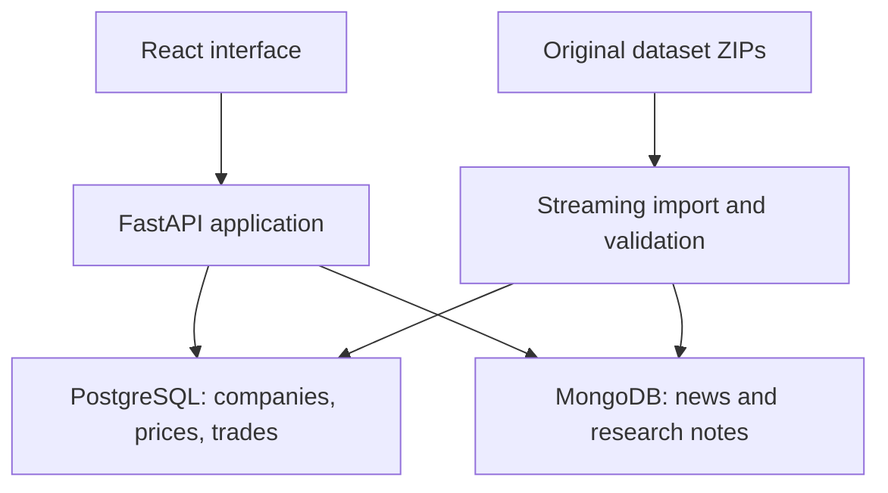
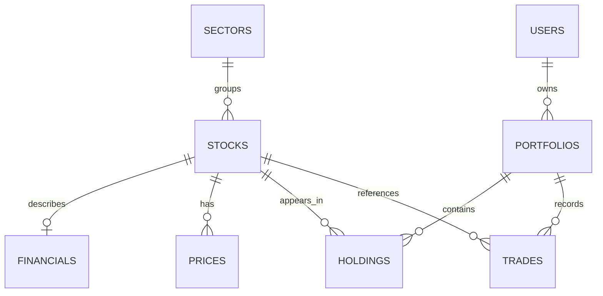

# Architecture and schema

React is served from FastAPI's static directory after a production build. All browser requests use relative `/api` URLs. FastAPI uses parameterised psycopg queries for SQL and PyMongo queries for documents. Runtime dependencies and frontend dependencies are pinned; Docker major/minor image tags should be pinned to tested digests for archival reproducibility.

## Relational model

`annual_fundamentals` adds dated SEC annual facts and provenance as the tenth table. `import_runs` and records completed imports, source and JSONB counters. It is deliberately independent of operational entities.

| Table | Key and purpose |
|---|---|
| sectors | Identity PK; unique sector name |
| stocks | Canonical ticker PK; sector FK; company name and SEC source URL |
| financials | Ticker PK/FK; one undated supplied snapshot; numeric ratios and data-source text |
| prices | Composite ticker/date PK; numeric OHLC/adjusted close, bigint volume |
| users | Integer PK; seeded shared demo identity |
| portfolios | Identity PK; user FK; numeric initial cash/cash; starting/current date and price basis |
| holdings | Portfolio/ticker composite PK; resolves portfolio–stock many-to-many relation |
| trades | Identity PK; portfolio/stock FKs; unique UUID retry key; side, quantity, price, amount, execution date |
| annual_fundamentals | Ticker PK/FK; bounded annual revenue/income sample, cutoff and filing provenance |
| import_runs | Identity PK; JSONB counters and timestamp |

The stock/sector relationship separates repeated sector labels. Daily prices are separate from the one supplied financial snapshot, preventing duplicated financial ratios on every price row. Stored holdings and cash are deliberate transactional summaries maintained together with the ledger.

Composite price PK supports ticker/date lookup. Trades have a portfolio/id index. `stock_metrics` joins company, sector and financial data. `sector_averages` uses conditional aggregates to exclude nonpositive valuation multiples.

## MongoDB model

`news` documents contain deterministic SHA-256 `_id`, canonical ticker, UTC BSON datetime, headline, publisher, source URL, sentiment and method label. The hash deduplicates identical ticker/time/headline rows, preserving a distinct association when a headline concerns multiple stocks. Only `raw_analyst_ratings.csv` is imported; processed/raw alternatives are not combined blindly. Optional publisher/source fields suit the document model, but this dataset could also fit SQL; schema flexibility is a design choice, not proof of SQL inadequacy.

The validator requires ticker/title strings, a date and sentiment in [-1,1]. Indexes cover `(ticker, date descending)` and date. The `_id` index enforces deduplication. Monthly sentiment uses `$match`, `$group`, `$dateToString`, `$avg`, `$sum`, `$sort` and `$limit`.

`notes` stores ticker, free-form text and updated timestamp, indexed by ticker/time. API validation rejects nonexistent stocks and blank text. These checks are application-level: MongoDB has no foreign key to PostgreSQL. Direct database writes can violate cross-store ticker consistency. No cross-database transaction is claimed or needed for paper trades; all monetary records are in SQL.

## Trade transaction

Within one SQL transaction: lock the portfolio row with `SELECT ... FOR UPDATE`; validate idempotency; retrieve a nonfuture quote; check cash/holdings; update cash and holdings; insert the trade; commit. An exception rolls back all mutations. All trade writers lock the same portfolio row before calculating balances. Unique retry IDs prevent duplicate ledger entries. Cross-portfolio UUID collisions are rejected by the unique constraint; clients must generate fresh UUIDs.

Quantity uses decimal arithmetic; cash/amount uses four decimal places. Small trades whose rounded value is zero are rejected. No short selling or margin is supported.

References: PostgreSQL explicit locking documentation, https://www.postgresql.org/docs/17/explicit-locking.html ; PyMongo index documentation, https://www.mongodb.com/docs/languages/python/pymongo-driver/current/indexes/ .
