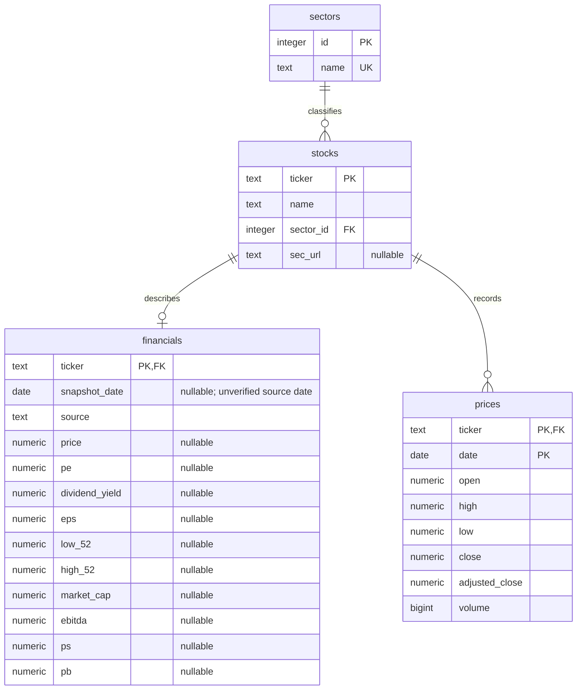
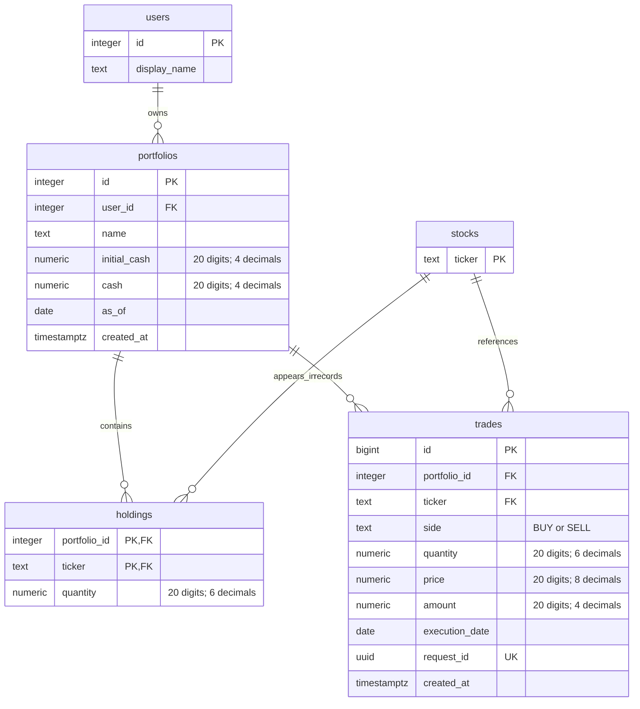

# Attribute-level relational ERD

The SQL schema is authoritative. Diagrams split reference data from portfolio operations to remain readable. `stocks` appears in both diagrams as the same table. All foreign keys are mandatory unless explicitly described otherwise. Nullable financial measures represent unavailable source data, not zero.

## Company and market data

## Portfolio operations

The holdings junction resolves the many-to-many portfolio/stock relationship. Deleting a portfolio cascades to its holdings and trades. Deleting a referenced stock is restricted by the default foreign-key behaviour. The current app shares one demo user; this schema is not evidence of implemented authentication.

## Import provenance

`import_runs` is independent: `id bigint PK`, `source text`, `details jsonb`, `completed_at timestamptz`. All four are non-null; identity and timestamp are generated. JSONB details record selected dates, accepted/rejected counts and corrections.

## Constraints and functional dependencies

- Sector ID determines unique sector name; ticker determines company/sector.
- Ticker determines the one supplied financial snapshot; multiple snapshots would require a different key before historical fundamentals are added.
- `(ticker,date)` determines daily OHLCV values.
- `(portfolio_id,ticker)` determines current held quantity.
- Trade ID and unique request UUID each identify one trade.
- Positive prices/trade quantities, nonnegative cash/holdings/volume, ordered high/low and valid trade side are database constraints.
- Preventing overselling across transactions requires application checks under a portfolio row lock; a CHECK constraint alone cannot inspect other rows.
- Cash and holdings are deliberate stored summaries of operations and must be updated atomically with the trade ledger.

## Views and document relationships

`stock_metrics` is the joined company snapshot; `sector_averages` provides conditional aggregates; `stock_scores` uses full-sector window ranks, tie counts and peer counts before filtering.

MongoDB `news` and `notes` link by canonical ticker. This is an application convention, not a cross-database foreign key. See ARCHITECTURE.md for document fields, indexes, validator and aggregation pipeline.
